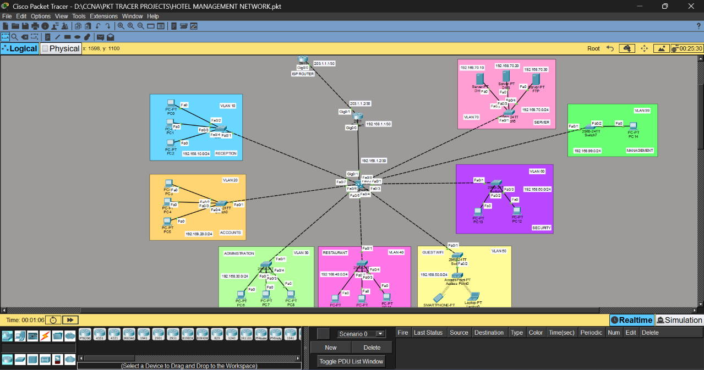

## Project Overview
Designed and simulated a Hotel Management Network using Cisco Packet Tracer. The project represents a hotel network environment for connecting different departments and supporting reliable communication.

## Objectives
- Design a structured hotel network topology.
- Provide network connectivity between hotel departments.
- Configure IP addressing and network devices.
- Test connectivity between connected devices.

## Technologies Used
- Cisco Packet Tracer
- Network Topology Design
- IP Addressing
- Switching and Routing
- Network Connectivity Testing

## Topology

## Project File
Open `HOTEL MANAGEMENT NETWORK.pkt` using Cisco Packet Tracer to explore the network topology and configuration.

## Verification
Connectivity can be tested using the `ping` command and relevant device configuration commands.
